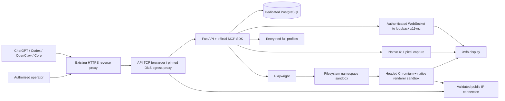

# DAOOS Browser architecture

The API and browser executor share one service. FastAPI exposes authenticated
REST operations and the official MCP SDK 2.3.0 Streamable HTTP endpoint. Agents
provide plans: the service does not contain an LLM, autonomous planner or Flow.
The same transport works independently and as a Core executor.
A bounded persistent command actor owns browser calls independently of transient
HTTP/MCP cancellation scopes. A client disconnect cannot silently replay a write.

The browser container has only an **internal** Docker network. A small dual-homed
edge service provides pinned-IP CONNECT/HTTP egress and forwards ingress TCP to
FastAPI. No VNC, X11 or debugging port is published. The database is separate and
is not shared with production Core or CRM. Defaults: one active browser, one API
worker. Increasing workers or replicas is unsupported until session scheduling
and distributed control are implemented.

Every session has an X display, a persistent profile directory on tmpfs, a headed
Chromium process, a restricted Openbox window manager and a loopback x11vnc port.
Desktop launch menus and keyboard launchers are disabled. Native pixel capture
uses this same X display; it never creates a headless second browser. Element
images crop visible screen pixels. Full-page images collect actual scroll tiles
and restore the initial scroll position. Fixed/sticky content can repeat between
tiles and changing pages are not an atomic capture. Request ordinary viewport
images on production pages when scrolling could trigger lazy-loading side effects. Playwright uses an inherited pipe;
there is no public CDP. Native Chromium sandboxing stays enabled. Bubblewrap
also hides `/data`, secrets, other profiles and host process `/proc` from the
browser broker. The sandbox is fail-closed: there is no fallback to no-sandbox.
The provided seccomp policy is from the official Playwright repository. This
host requires the dedicated `apparmor=daoos-browser` profile for nested user namespaces, plus unmasked container proc paths; the custom seccomp
and both browser sandboxes remain enabled. Validate this choice on each host.

An agent action holds the session lock. Operator takeover waits for the current
command, marks a task waiting_for_user and replaces the VNC server in interactive
mode. Returning control replaces it in view-only mode. Both transitions close
old RFB connections, preventing a stale interactive connection from continuing.
Resuming a paused task requires a separate resume_task command. Human operator
activity itself is not interpreted as browser instructions or replayed as a plan.

Profiles are full-directory encrypted archives, including cookies, localStorage
and IndexedDB, saved only **after** Chromium closes. Session cookies are checkpointed before close and re-added on explicit profile
reopening, because Chromium normally discards session-only cookies on exit.
This checkpoint is inside the same encrypted archive. Plaintext runtime is deleted.
The archive key is an external secret; a key lost without backup makes profiles
unrecoverable. A crash can lose the latest unsaved profile changes. Saved profile
reopening is explicit and never called restoration of a live session.

Persistent owner-scoped tables represent User, Organization, ApiKey,
BrowserProfile, BrowserSession, BrowserTask, BrowserAction, UsageRecord, Quota,
BillingAccount, approvals and OAuth records. The schema uses JSON documents for
MVP attributes with indexed owner columns. PostgreSQL is deployed; SQLite is
used only in unit tests. Future schema changes require versioned migrations;
`create_all` is sufficient only for this initial schema.

Action receipts reserve a globally unique owner/request_id before executing.
A repeated ID returns the stored outcome and never executes the interaction
again. Reusing an ID with a changed command is rejected. A crash marks in-flight
actions uncertain and sessions lost; queued/running tasks fail with the explicit
session-loss reason. Cancellation cannot undo an already dispatched website
request. Never retry uncertain actions with a new ID without checking the site.

Usage events use unique IDs. A PostgreSQL quota-row lock, per-key counter and
ledger insertion commit atomically; duplicate events cannot double charge.
Counts include accepted attempts. Browser time is metered periodically and at
close; CPU/memory samples are best effort, not payment-grade precision. After
an abrupt process loss the final unmetered interval is unknown and marked
incomplete. Memory samples are gauges in bytes, not billable byte totals.
BillingProvider is an independent interface; no payment provider, collection,
prepaid balance mutation or real money handling is implemented.
